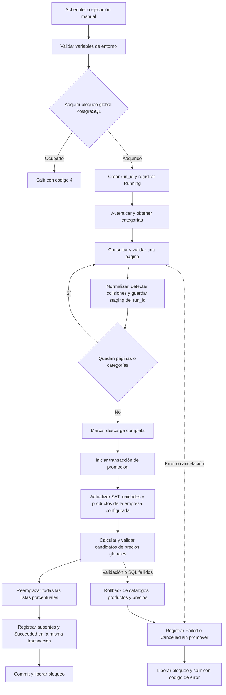

# Sincronización SYSCOM → IDOne

Consola .NET 10 ejecutada por un scheduler externo. Descarga catálogo y precios de
SYSCOM y escribe PostgreSQL; no envía cambios al proveedor ni sincroniza existencias.

## Componentes

- `SyscomApp`: configuración por entorno, códigos de salida, cancelación y recursos.
- `SyscomClient`: OAuth, renovación, límites de tiempo y recuperación HTTP.
- `SyscomWorker`: ejecución secuencial, categorías ordenadas y persistencia por página.
- `SyscomDatabaseWorker`: bloqueo, historial, staging por ejecución y promoción transaccional.
- `IDOneRepository`: contexto EF Core y Unit of Work; SQL parametrizado sobre la misma conexión.

## Flujo

## Persistencia y compatibilidad

La primera ejecución crea tablas aditivas `syscom_sync_runs`, `syscom_sync_staging`
y `syscom_sync_missing`. La tabla anterior `syscom_products_staging` se conserva,
pero no se consulta ni se mezcla con la nueva descarga. No se requiere borrar datos
existentes. El usuario de DB necesita permisos de creación y modificación de estas
tablas, además de los permisos existentes sobre catálogos, productos y precios.

El bloqueo de sesión es global para estos workers en una misma base. Procesos antiguos
que no conocen el bloqueo deben retirarse antes de activar esta versión. Una ejecución
posterior registra como interrumpidas las ejecuciones que quedaron Running tras una
terminación abrupta. Una cancelación cooperativa intenta guardar Cancelled con tiempo
limitado; una pérdida de conexión puede impedir ese último registro.

La retención elimina historial vencido mediante cascada, conservando la última ejecución
exitosa de cada empresa como referencia. Los productos ausentes se registran contra
esa referencia; no se eliminan ni inactivan automáticamente.

Cada página se guarda en su propia transacción. Solo una descarga completa puede
promoverse. Catálogos, productos, precios, ausentes y éxito se confirman juntos.
No se reintenta automáticamente una promoción SQL fallida.

## Reglas de datos y alcance global

- Modelo: trim, mayúsculas, máximo 35 caracteres; colisiones entre modelos completos
  diferentes que producen el mismo código abortan la ejecución.
- Duplicados: selección determinista por categoría, producto y campos de desempate.
- Precio: prioridad descuento, lista, precio 1 y especial; cuatro decimales, USD.
- Clave SAT inválida: `46171604`; registros incompletos se omiten y cuentan.
- Productos: coincidencia por empresa y código; la empresa por defecto sigue siendo 1.
- Precios: **todas las listas con percent_reference y todos los productos**, incluso
  productos ajenos a SYSCOM o de otras empresas. Las listas sin porcentaje se conservan.
- Candidatos inválidos, monedas/tipos de cambio faltantes, tipos no positivos o ambiguos
  y conversiones no soportadas impiden el reemplazo y revierten la promoción.
- Se mantienen conversiones entre moneda principal y secundaria, o misma moneda.
  Una conversión entre dos monedas secundarias distintas se rechaza; no se inventa
  un tipo cruzado. La cantidad cero/nula conserva el divisor 1 de la regla anterior.

## Configuración

Obligatorias: `CONNECTION_STRING` (Npgsql), `SYSCOM_CLIENT_ID`, `SYSCOM_CLIENT_SECRET`.
No se carga `.env` automáticamente. Proveer variables al proceso/scheduler. El ejemplo
sin secretos está en `Syscom/SyscomApp/environment.example`.

| Variable opcional | Valor por defecto |
| --- | --- |
| SYSCOM_COMPANY_ID | 1 |
| SYSCOM_RETENTION_DAYS | 30 |
| SYSCOM_MAXIMUM_DURATION_SECONDS | 1800 |
| SYSCOM_REQUEST_TIMEOUT_SECONDS | 30 |
| SYSCOM_BASE_URL | https://developers.syscom.mx |
| SYSCOM_OAUTH_TOKEN_PATH | /oauth/token |
| SYSCOM_OAUTH_FORM_ENCODED | false |

Se conserva el contrato OAuth histórico JSON por compatibilidad. La
[guía actual del proveedor](https://developers.syscom.mx/guide) documenta
`/api/v1/oauth/token` con formulario: se puede configurar con las dos últimas variables.
No se verificó autenticación real de ninguna variante con la cuenta del usuario.
Los redirects HTTP están desactivados en la consola.

El cliente renueva por expires_in y permite una renovación adicional ante 401.
Los GET tienen hasta cuatro intentos por fallas transitorias, más la repetición de
401; backoff con jitter y respeto de Retry-After, acotados por dos minutos por GET
y la duración global. No se reintenta ciegamente el POST de token. Los errores no
incluyen cuerpos HTTP ni detalles de conexión en los logs de la consola/worker.

Códigos de salida: 0 éxito, 1 error, 2 configuración inválida, 3 cancelación o límite
de ejecución, 4 sincronización ocupada. Ctrl+C y SIGTERM solicitan cancelación.

## Validación y activación

Las pruebas con SYSCOM real quedan omitidas por defecto; la prueba que escribe requiere
opt-in, variables `SYSCOM_INTEGRATION_*` y confirmación de una base aislada.
La [simulación local](../../postman/README.md) ejercita HTTP real con datos ficticios y
PostgreSQL desechable. No demuestra permisos, límites ni datos de una cuenta real.

Antes de activar en un ejecutor real: provisionar las variables, revisar permisos y
monedas, detener la versión anterior y validar la primera ejecución. Los secretos
retirados del código siguen en el historial Git; su rotación y el cambio de variables
remotas requieren coordinación y no fueron ejecutados en este cambio.

[Plan y estado de implementación](../changelog/261030-001-FEATURE-sincronizacion-syscom/plans/main/PLAN.md).
