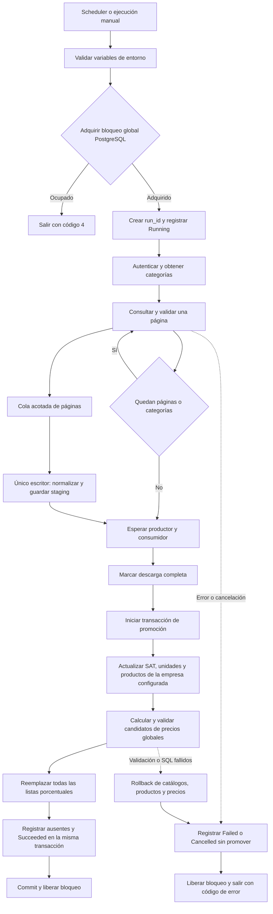

# Sincronización SYSCOM → IDOne

Consola .NET 10 ejecutada por un scheduler externo. Descarga catálogo y precios de
SYSCOM y escribe PostgreSQL; no envía cambios al proveedor ni sincroniza existencias.

## Componentes

- `SyscomApp`: configuración por entorno, códigos de salida, cancelación y recursos.
- `SyscomClient`: OAuth, renovación, límites de tiempo y recuperación HTTP.
- `SyscomWorker`: descarga secuencial, categorías ordenadas y escritura solapada por página.
- `SyscomDatabaseWorker`: bloqueo, historial, staging por ejecución y promoción transaccional.
- `IDOneRepository`: contexto EF Core y Unit of Work; SQL parametrizado sobre la misma conexión.

## Flujo

## Ciclo de verificación y corrección

1. Confirmar el destino local y capturar los IDs existentes y las filas de listas fijas.
2. Compilar y ejecutar una sincronización completa contra SYSCOM, sin procesos paralelos
   que promuevan datos sobre la misma base.
3. Si falla, correlacionar `run_id`, etapa, motivo seguro, SQLSTATE y contadores.
   Si falta información, añadir diagnóstico estructurado sin credenciales ni payloads.
4. Reproducir la causa, agregar una regresión y aplicar la corrección mínima.
   Ejecutar las pruebas afectadas y crear un commit por fix con su documentación.
5. Volver a ejecutar el flujo completo. No darlo por resuelto solo porque una etapa avance.
6. Aceptar únicamente con salida 0, `Succeeded`/`Complete`, promoción completa,
   precios globales correctos, IDs previos conservados y listas fijas sin cambios.

El orquestador controla ejecución, escrituras y commits. Los agentes de diagnóstico
revisan causas; un verificador independiente contrasta los resultados de la base.
Este ciclo es de mantenimiento: no añade reintentos automáticos de promoción al worker.

## Persistencia y compatibilidad

La primera ejecución crea tablas aditivas `syscom_sync_runs`, `syscom_sync_staging`
y `syscom_sync_missing`. La tabla anterior `syscom_products_staging` se conserva,
pero no se consulta ni se mezcla con la nueva descarga. No se requiere borrar datos
existentes. El usuario de DB necesita permisos de creación y modificación de estas
tablas, además de los permisos existentes sobre catálogos, productos y precios.

El bloqueo de sesión es global para estos workers en una misma base. Procesos antiguos
que no conocen el bloqueo deben retirarse antes de activar esta versión. Una ejecución
posterior registra como interrumpidas las ejecuciones que quedaron Running tras una
terminación abrupta. Una cancelación cooperativa intenta guardar Cancelled con tiempo
limitado; una pérdida de conexión puede impedir ese último registro.

La retención elimina historial vencido mediante cascada, conservando la última ejecución
exitosa de cada empresa como referencia. Los productos ausentes se registran contra
esa referencia; no se eliminan ni inactivan automáticamente.

Cada página se guarda en su propia transacción, en lotes de hasta 500 registros.
Se verifica el avance de páginas, se rechazan páginas vacías de una descarga no vacía
y se compara la cantidad recibida con el total positivo anunciado por el proveedor.
Si cantidad no es positiva o no está informada, no se puede verificar aritméticamente
el total; se aplican las guardas de avance y páginas vacías.
Solo una descarga completa puede
promoverse. Catálogos, productos, precios, ausentes y éxito se confirman juntos.
La confirmación es asíncrona y respeta la cancelación.
No se reintenta automáticamente una promoción SQL fallida.

## Reglas de datos y alcance global

- Modelo: trim y mayúsculas, conservando el contenido completo; code usa text.
  Los modelos diferentes con un prefijo común se conservan separados.
- Duplicados: selección determinista por categoría, producto y campos de desempate.
- Precio: prioridad descuento, lista, precio 1 y especial; cuatro decimales, USD.
  Solo se ingresan productos con precio seleccionado mayor que cero; los demás se omiten y cuentan.
- Clave SAT inválida: `46171604`; registros incompletos se omiten y cuentan.
- Productos: coincidencia por empresa y código; la empresa por defecto sigue siendo 1.
- Precios: **todas las listas con percent_reference y todos los productos con precio fuente positivo**, incluso
  productos ajenos a SYSCOM o de otras empresas. Las listas sin porcentaje se conservan.
- Candidatos inválidos, monedas/tipos de cambio faltantes, tipos no positivos o ambiguos
  y conversiones no soportadas impiden el reemplazo y revierten la promoción.
- Se mantienen conversiones entre moneda principal y secundaria, o misma moneda.
  Entre monedas secundarias se usa precio × tasa principal de origen ÷ tasa principal
  de destino, ambas configuradas y positivas. La cantidad cero/nula conserva el divisor 1.

## Configuración

Obligatorias: `ALUSA_CONNECTION_STRING` (Npgsql), `SYSCOM_CLIENT_ID`, `SYSCOM_CLIENT_SECRET`.
No se carga `.env` automáticamente. Proveer variables al proceso/scheduler. El ejemplo
sin secretos está en `Syscom/SyscomApp/environment.example`.

| Variable opcional | Valor por defecto |
| --- | --- |
| SYSCOM_PAGE_SIZE | 500; permitido 10–1000 |
| SYSCOM_BUFFERED_PAGES | 2; permitido 1–16 |
| SYSCOM_COMPANY_ID | 1 |
| SYSCOM_RETENTION_DAYS | 30 |
| SYSCOM_MAXIMUM_DURATION_SECONDS | 1800 |
| SYSCOM_REQUEST_TIMEOUT_SECONDS | 30 |
| SYSCOM_BASE_URL | https://developers.syscom.mx |
| SYSCOM_OAUTH_TOKEN_PATH | /oauth/token |
| SYSCOM_OAUTH_FORM_ENCODED | false |

Se conserva el contrato OAuth histórico JSON por compatibilidad. La
[guía actual del proveedor](https://developers.syscom.mx/guide) documenta
`/api/v1/oauth/token` con formulario: se puede configurar con las dos últimas variables.
No se verificó autenticación real de ninguna variante con la cuenta del usuario.
Los redirects HTTP están desactivados en la consola.

El cliente renueva por expires_in y permite una renovación adicional ante 401.
Los GET tienen hasta cuatro intentos por fallas transitorias, más la repetición de
401; backoff con jitter y respeto de Retry-After, acotados por dos minutos por GET
y la duración global. No se reintenta ciegamente el POST de token. Los errores no
incluyen cuerpos HTTP ni detalles de conexión en los logs de la consola/worker.

Códigos de salida: 0 éxito, 1 error, 2 configuración inválida, 3 cancelación o límite
de ejecución, 4 sincronización ocupada. Ctrl+C y SIGTERM solicitan cancelación.

## Validación y activación

Las pruebas con SYSCOM real quedan omitidas por defecto; la prueba que escribe requiere
opt-in, variables `SYSCOM_INTEGRATION_*` y confirmación de una base aislada.
La [simulación local](../../postman/README.md) ejercita HTTP real con datos ficticios y
PostgreSQL desechable. No demuestra permisos, límites ni datos de una cuenta real.

Antes de activar en un ejecutor real: provisionar las variables, revisar permisos y
monedas, detener la versión anterior y validar la primera ejecución. Los secretos
retirados del código siguen en el historial Git; su rotación y el cambio de variables
remotas requieren coordinación y no fueron ejecutados en este cambio.

[Plan y estado de implementación](../changelog/261030-001-FEATURE-sincronizacion-syscom/plans/main/PLAN.md).

## Rendimiento y medición

La descarga mantiene una sola petición de productos activa. Mientras llega la página
siguiente, un único consumidor normaliza y escribe la anterior. La cola aplica
contrapresión: conserva hasta `SYSCOM_BUFFERED_PAGES` páginas, más una en descarga y
una en escritura. Los lotes SQL internos siguen limitados a 500 registros.
Ambas tareas terminan antes de promover o registrar un error; una falla detiene a
su pareja. Las páginas descargadas no garantizan páginas confirmadas si ocurre una falla.

Cada ejecución registra milisegundos con reloj monótono: preparación, descarga
(incluidas categorías, autenticación y reintentos), staging, promoción de catálogos,
recálculo global de precios, promoción completa y tiempo total transcurrido.
La columna aditiva `syscom_sync_runs.metrics` contiene el snapshot JSON; también se
emite un resumen en logs. El registro de métricas tiene un límite de cinco segundos
y no reemplaza el resultado de negocio si falla. Ejecuciones históricas pueden tener
metrics nulo.

Descarga y staging se solapan; promoción contiene catálogos y precios. **No sumar las
etapas para obtener el total.** El total persistido se toma antes de guardar métricas
y liberar el bloqueo; el resumen puede ser ligeramente posterior.

[Plan de rendimiento](../changelog/261030-002-FEATURE-rendimiento-sincronizacion-syscom/plans/main/PLAN.md).

## Diagnóstico seguro de fallas

El log de error incluye run_id, tipo de excepción y Reason. Las validaciones propias
registran causas específicas (ProductTotalChanged, PageCountChanged, UnexpectedPage,
EmptyPage, ModelCodeCollision, entre otras) y contexto numérico de categoría, página
y cantidades esperadas/recibidas. No registra modelos, títulos ni contenido del proveedor.
Las excepciones externas se clasifican sin imprimir Message, InnerException, Data,
respuestas HTTP o cadenas de conexión; HTTP incluye únicamente el código de estado.
Una excepción inesperada conserva diagnóstico genérico y requiere inspección en debugger.

Validación local del cambio de logging: 81 pruebas PASS y 9 omitidas (proveedor real
y simulador no iniciado), con PostgreSQL desechable. Incluye salida del logger,
conteo cambiante y mensajes señuelo con secretos. La causa de la ejecución real
reportada no se puede recuperar del log anterior; requiere una nueva ejecución.

Las colisiones incluyen existing_product_id, incoming_product_id y existing_category.
requested_page identifica la página que el consumidor estaba guardando al fallar,
incluso si el productor ya había descargado páginas posteriores. No se omite la
colisión ni se promueven datos incompletos.

## Modelos completos y conservación de IDs

Requiere primero la migración `20261030230000_expand_portfolio_product_codes` de
IDOneApi: portfolio_products.code pasa a text. Rails elimina el límite35 y la
importación de productos deja de recortar códigos. La migración conserva índices,
IDs y referencias; recrea vistas dependientes con definiciones, propietarios, ACLs,
opciones y comentarios. Se detiene si encuentra materializaciones, triggers, reglas
o metadatos de columna que necesitan una migración específica. El rollback no
recorta datos: está declarado irreversible.

Extensions verifica el tipo de la columna antes de descargar. Si aún tiene límite,
emite CodeSchemaMigrationRequired. Su staging y tabla de ausentes se amplían a text
sin borrar historial. Ya no existe la excepción específica para246645.

Durante la promoción transaccional se buscan códigos truncados a35 caracteres y
alias históricos SYSCOM-ID. Se mantiene el ID existente actualizando únicamente su
código cuando el prefijo/alias tiene un único candidato en el catálogo descargado,
aunque haya cambiado el título. Si hay varios candidatos, exige una coincidencia
única de título. Los títulos comparados son los mismos que almacena la
sincronización (máximo350). Un código que ya coincide con un modelo completo
descargado conserva su identidad. No se fusionan IDs ni se borran productos.

Si no hay coincidencia única, o el destino pertenece a otro ID, se revierte con
LegacyCodeIdentityAmbiguous. Esto requiere reconciliación explícita de datos, no
seleccionar arbitrariamente el primer producto. El alias y código truncado de un
mismo producto tampoco se fusionan silenciosamente si ambos existen.

La reconciliación, actualización de catálogos, recálculo GLOBAL de precios y estado
Succeeded comparten transacción. Se conservan listas fijas y referencias por ID.
La detección de ausentes compara modelos completos históricos para no reportar
como faltante un producto cuyo código se amplió.

Validación local de esta solución:93 pruebas .NET PASS,9 omitidas (SYSCOM real y
simulador),4 pruebas Ruby PASS con PostgreSQL17 desechable. Se probaron colisiones
por prefijo en la misma página y entre páginas, ambos órdenes, reejecución, alias
histórico, identidad ambigua, destino ocupado, referencias, listas fijas, rollback
de renombres tras falla de precios y migración del staging. En Ruby: vistas
dependientes, permisos/comentarios/opciones, unicidad, IDs/FKs, modelos de306
caracteres, fallo seguro de dependencias no soportadas y rollback irreversible.

No se ejecutó la migración ni la sincronización contra la base real. Orden de
activación: detener el worker, aplicar migración de API, desplegar ambos cambios,
ejecutar sincronización. No ejecutar el worker antiguo después de la ampliación:
su recorte podría volver a insertar códigos antiguos. Una ampliación por sí sola
no identifica a qué producto pertenece cada código histórico ambiguo.

Ajuste por run fc69ea78-5039-4002-9c0d-32da049efb82: los registros199521/199522
tenían un único candidato por prefijo (246322/246329), con descripciones cambiadas.
Se reprodujo el rechazo con un test fallido y se corrigió la selección del candidato
único. Se conservan guardas para varios candidatos sin título único, dos IDs hacia
el mismo código y destino ocupado.

## Unidades SAT históricas duplicadas

El run6135ff3b-e01b-4250-8fde-796adf782486 falló con SQLSTATE21000 porque el
JOIN de unidades generaba varias filas por producto. La base local contiene
varias filas por sat_key/store_type (incluidas10 para H87/0); no se supone
unicidad que el esquema real no impone.

La promoción elige una sola unidad con JOIN LATERAL: conserva la referencia del
producto existente si coincide SAT/tipo, o utiliza el menor ID válido. No elimina
ni fusiona unidades históricas. El test reprodujo21000 antes del cambio y luego
verificó dos ejecuciones, referencias estables y precios globales. La consulta
local de solo lectura devuelve32729 filas y32729 códigos únicos para ese run.
Suite:96 PASS,9 SKIP; sin ejecutar promoción real desde esta sesión.
Los errores PostgreSQL muestran SQLSTATE validado y una clasificación estática;
Message/Detail/Hint y credenciales siguen excluidos del log.

## Monedas secundarias con principal nulo

La base histórica guarda principal=NULL para USD/EUR. La conversión con moneda
principal interpreta ese NULL como false, pero exige que exista la fila de moneda
y que el tipo de cambio aplicable sea positivo. Se reprodujo InvalidPriceCandidates
con flags nulos en un test fallido antes de corregir la consulta. El diagnóstico
agrega invalid_count, separado del total esperado y generado.

Reglas confirmadas por el usuario: excluir precios fuente nulos, cero y negativos;
convertir entre monedas secundarias usando las tasas principales configuradas.
El recálculo sigue siendo global entre empresas para los productos elegibles.
Los productos históricos excluidos conservan sus IDs y sus precios de listas fijas;
sus entradas en listas porcentuales se retiran durante el reemplazo transaccional.

Validación: 100 PASS, 9 SKIP. Consulta de solo lectura sobre el catálogo local:
521550 candidatos, 0 inválidos. Regresiones verifican omisiones, productos históricos,
listas fijas y conversión EUR/USD en ambos sentidos tras cambiar la tasa configurada.
La verificación inicial de solo lectura se completó después con una sincronización real
contra SYSCOM y promoción en la base local; resultado descrito abajo.

## Verificación completa — 30 de octubre de 2026

La revisión `c844751` completó la descarga real de SYSCOM y la promoción sobre
`one_development` local: salida 0 y estado persistido `Succeeded` / `Complete`.
No se ejecutó contra la base productiva. El equipo utilizó dos agentes GPT-6 Sol
con esfuerzo alto para diagnóstico y verificación, con ejecución y commits a cargo
del orquestador.

- 100 páginas; 46651 registros recibidos; 0 omitidos; 32728 modelos únicos promovidos.
  El conteo recibido incluye repeticiones entre categorías: no equivale a modelos únicos.
- 583470 precios porcentuales recalculados globalmente: 583362 de empresa 1,
  72 de empresa 2 y 36 de productos sin empresa asignada.
- Todos los modelos del staging coinciden con los productos promovidos en código,
  título, moneda y precio. No hay candidatos inválidos ni pares lista/producto duplicados.
- La comparación de todos los precios esperados contra los persistidos encontró
  cero faltantes, sobrantes o valores distintos.
- Se conservaron los 65355 IDs existentes; no se crearon IDs nuevos en esta ejecución.
  Las filas completas de listas fijas mantuvieron el mismo contenido y sus IDs.
- Tiempo total: 105.9 s; descarga: 98.8 s; staging: 2.56 s; promoción de catálogo:
  1.05 s; recálculo global: 5.84 s. Descarga y staging se solapan.

Esta comprobación confirma una ejecución completa en el entorno local. No constituye
un despliegue productivo ni garantiza disponibilidad futura del proveedor.
