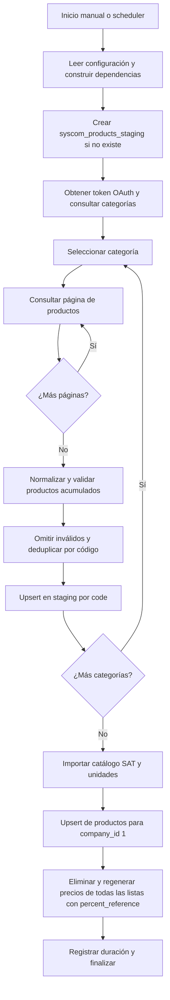

# Sincronización SYSCOM → IDOne

## Arquitectura

Aplicación de consola .NET 10 que ejecuta una sincronización y termina. La frecuencia
la determina un scheduler externo; el código no contiene un temporizador.

- `SyscomApp/Program.cs`: configuración, dependencias, logs y cancelación.
- `Syscom/SyscomClient.cs`: autenticación OAuth client_credentials y consultas HTTP.
- `Syscom/Load/SyscomWorker.cs`: coordinación secuencial por categoría y página.
- `Syscom/Load/SyscomDatabaseWorker.cs`: transformación, staging e importación SQL.
- `../IDOneRepository`: EF Core/PostgreSQL, Unit of Work, repositorios y upsert FlexLabs.
- `../Utils`: deduplicación por código conservando el último registro.

## Flujo actual



Las consultas utilizadas son `POST /oauth/token`, `GET /api/v1/categorias` y
`GET /api/v1/productos?categoria=...&pagina=...`. Se acumula una categoría completa
antes de guardarla. No se sincronizan existencias ni se envían cambios a SYSCOM.

### Transformación y persistencia

- Código: `Modelo`, trim, mayúsculas y máximo 35 caracteres.
- Precio: primer valor no nulo entre descuento, lista, precio 1 y especial;
  conversión decimal, cuatro decimales y moneda USD.
- Clave SAT: ocho dígitos; en otro caso se usa `46171604`.
- Se omiten registros que no cumplen la validación de campos obligatorios.
- Staging: tabla fija `syscom_products_staging`, upsert por `code`.
  No se usa COPY, no hay tablas diarias y no se vacía la tabla entre ejecuciones.
- SAT: inserta códigos nuevos y completa títulos vacíos de los existentes.
- Unidades: actualiza e inserta por clave SAT para `store_type = 0`.
- Productos: upsert por `(company_id, code)`, con empresa fijada en 1.
- Precios: borra los registros de listas con `percent_reference` y los regenera
  cruzando esas listas con todos los productos, utilizando monedas, tipos de cambio,
  `pr_quantity` y porcentaje. Este alcance global es intencional y debe preservarse.

## Configuración y ejecución

La aplicación actual requiere estas variables de entorno:

- `CONNECTION_STRING`: cadena Npgsql de PostgreSQL.
- `SYSCOM_CLIENT_ID`.
- `SYSCOM_CLIENT_SECRET`.

```sh
dotnet run --project Syscom/SyscomApp
```

Ejecutar desde la raíz del repositorio, únicamente contra el entorno que se desea
sincronizar. La operación escribe catálogos, productos y precios en la base de datos.

## Límites operativos actuales

No hay reintentos HTTP, renovación por vencimiento del token, checkpoints ni bloqueo
entre ejecuciones. Un error detiene el flujo; las categorías ya guardadas permanecen
en staging. No hay una transacción explícita que cubra toda la ejecución. El worker
registra por separado éxito, cancelación y error; estos logs no sustituyen un historial
persistente de ejecuciones.

Los productos ausentes en una descarga posterior permanecen en staging y en destino.
La prueba `SyscomTestProject/SyscomWorkerTests.cs` usa credenciales y conexión
incrustadas y realiza escrituras reales; no debe tratarse como prueba unitaria aislada.

Consultar [el plan de mejora](PLAN-MEJORA.md) para los cambios propuestos.
